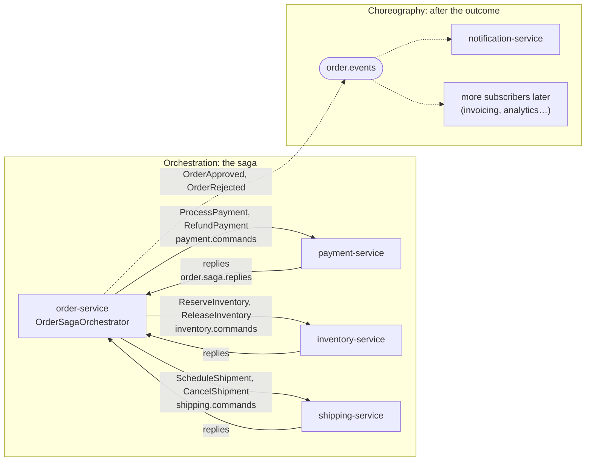
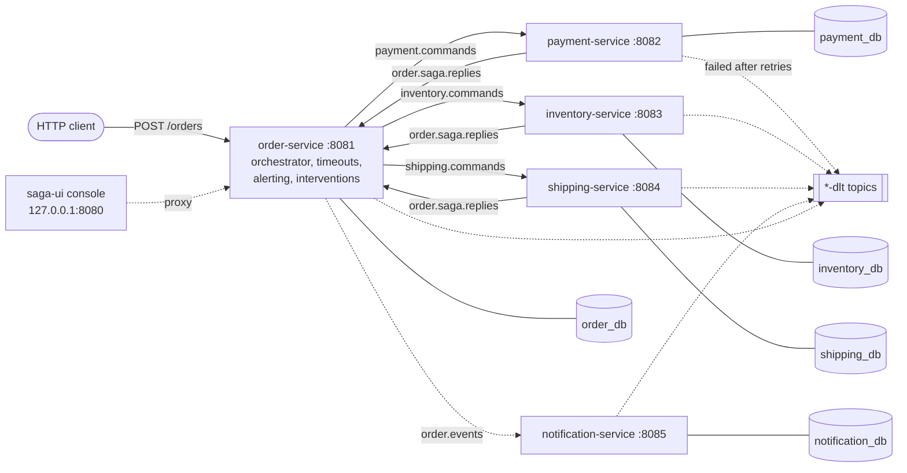
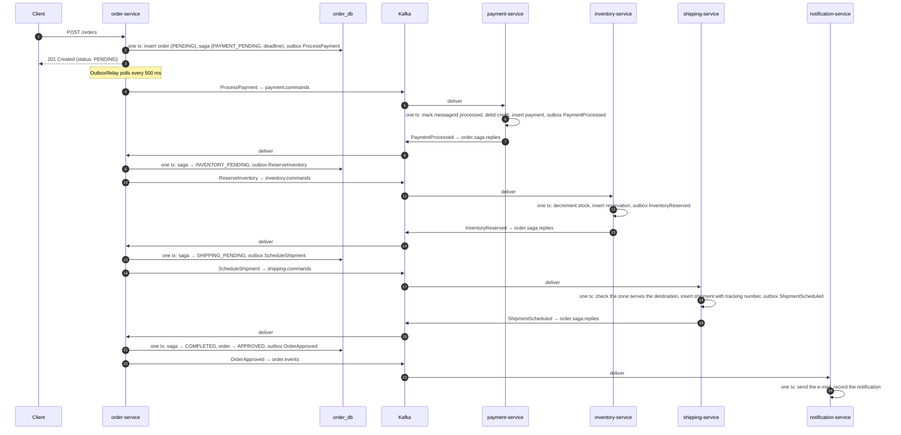
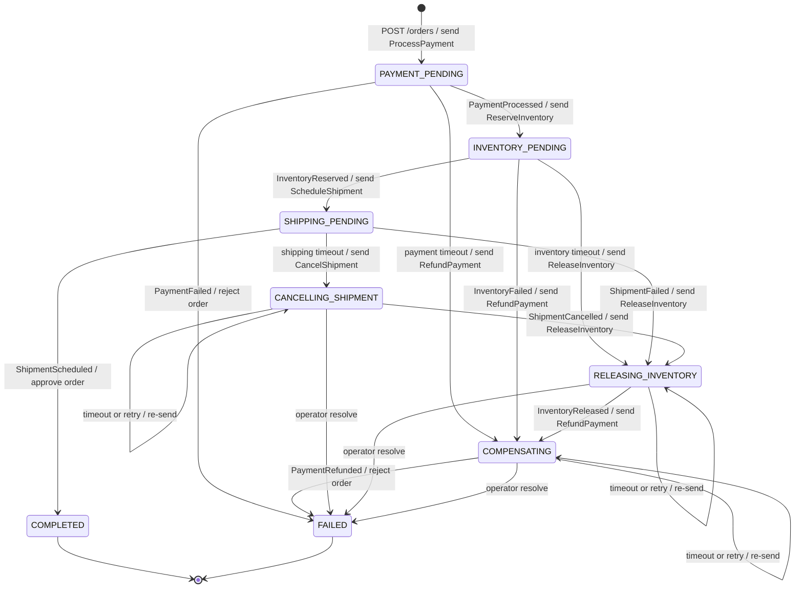
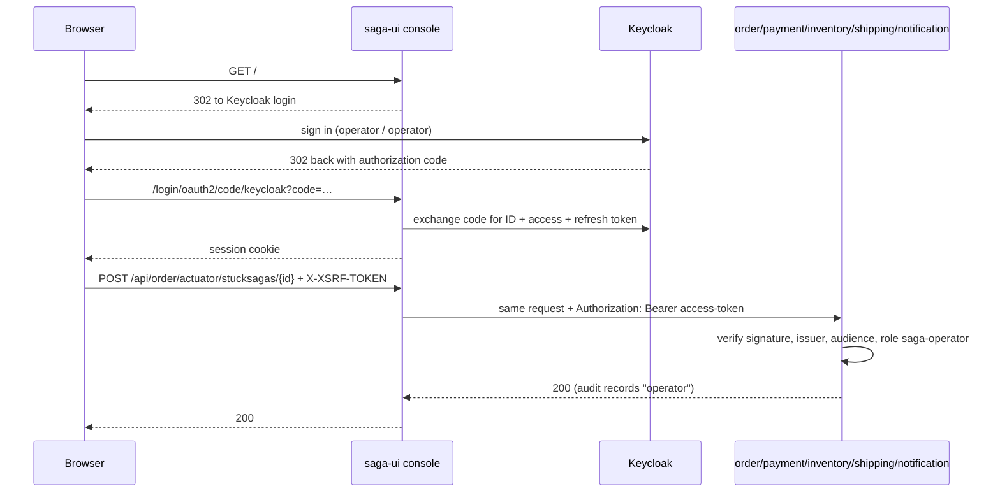

# Architecture

This document explains **what** the system does, **why** it is built this way, and **which code** implements each part. For hands-on exploration, pair it with [Scenarios](SCENARIOS.md). For a class-by-class tour, see [Codebase](CODEBASE.md).

- [1. The problem a saga solves](#1-the-problem-a-saga-solves)
  - [Orchestration and choreography](#orchestration-and-choreography)
- [2. System overview](#2-system-overview)
- [3. The happy path, message by message](#3-the-happy-path-message-by-message)
- [4. The saga state machine](#4-the-saga-state-machine)
- [5. Reliability building blocks](#5-reliability-building-blocks)
- [6. Failure modes](#6-failure-modes)
- [7. Data model](#7-data-model)
- [8. Operability](#8-operability)
- [9. Security](#9-security)
- [10. Key decisions and trade-offs](#10-key-decisions-and-trade-offs)

---

## 1. The problem a saga solves

Placing an order touches state owned by four services, and a fifth reacts to the result:

| Service | Owns | Must do |
|---|---|---|
| order-service | orders | record the order, decide its outcome |
| payment-service | customer credit, payments | charge the customer (and refund if needed) |
| inventory-service | product stock, reservations | reserve stock (and release if needed) |
| shipping-service | shipping zones, shipments | schedule the delivery (and cancel it if needed) |
| notification-service | notifications sent | tell the customer how the order ended |

Each service has **its own database**: that's what keeps services independent. The price is that no single ACID transaction can span them. A two-phase commit across services and Kafka would couple them tightly and block on any participant failure.

A **saga** replaces the one big transaction with a sequence of **local transactions**, one per service, connected by messages. Each step commits on its own. If a later step fails, the saga runs **compensating transactions** for the steps already done. A refund doesn't erase the original charge; it is a new, opposite action, and both are recorded.

This gives **eventual consistency**. For a short time the customer may be charged for an order that's about to be rejected; the saga guarantees it ends consistent: either approved, or rejected with everything undone.

### Compensatable, pivot and retriable steps
Not every step can be undone, so a saga orders its steps by what can go wrong:

| Kind | Steps here | Rule |
|---|---|---|
| **Compensatable** | charge payment, reserve stock | can fail, and can be undone later by a compensation (refund, release) |
| **Pivot** | schedule the shipment | the point of no return: if it succeeds the saga completes; if it fails, the compensatable steps before it are undone **in reverse order** |
| **Retriable** | notify the customer | comes after the pivot, so it must not fail the order; it is retried (and dead-lettered, then replayed) until it succeeds |

So when shipping refuses an order, the saga first releases the stock, then refunds the payment: the last thing done is the first undone.

### Orchestration and choreography
Something has to coordinate a saga's steps. Something must decide that stock is reserved once the payment has gone through, and that when shipping refuses, the stock is released first and the payment refunded after. There are two ways to do that, and this application uses both, each where it fits.

**Orchestration: one service directs.** A central **orchestrator** holds the saga's state and tells each participant what to do. It sends **commands**: imperative messages addressed to exactly one service ("charge this customer", "reserve this stock"). Then it waits for that service's **reply**. The participants don't know they're in a saga. Each one does its job and reports back, like musicians following a conductor.

**Choreography: services react to each other.** Nobody is in charge. A service publishes **events**: past-tense facts about something that has already happened ("order approved"). Any service that cares subscribes and reacts, and may publish events of its own. The flow is the sum of those reactions, like dancers who each know their cue.

| | Orchestration | Choreography |
|---|---|---|
| Message | a command, "do X", to one recipient; a reply comes back | an event, "X happened", to anyone listening; no reply |
| Where the flow lives | in the orchestrator, in one place | nowhere; it's spread across the subscribers |
| Coupling | the orchestrator knows each participant's commands; participants know nothing of each other | the publisher knows nothing of its subscribers; subscribers depend only on the event's shape |
| Adding a step | change the orchestrator | add a subscriber; the publisher doesn't change |
| Failures, timeouts, undo | the orchestrator notices and decides what to do | each service handles its own part; nobody sees the whole picture |
| Best for | steps that must happen in order, can fail the whole thing, or may need undoing | side effects that follow a final fact and can't change it |

#### Where each style is used

| What happens | Style | Messages and topics | Code |
|---|---|---|---|
| Charge, reserve, ship; on failure, undo in reverse order | orchestration | commands on `payment.commands`, `inventory.commands` and `shipping.commands`; replies on `order.saga.replies` | [`OrderSagaOrchestrator`](../order-service/src/main/java/com/saga/order/saga/OrderSagaOrchestrator.java) sends every command and handles every reply in `onReply`. Each participant's `*CommandHandler` does the work and replies |
| A participant doesn't answer in time | orchestration | the compensating command, re-sent until it's answered | [`SagaTimeoutScanner`](../order-service/src/main/java/com/saga/order/saga/SagaTimeoutScanner.java) calls `OrderSagaOrchestrator.onTimeout` |
| An operator retries or resolves a stuck saga | orchestration | the same commands | [`SagaInterventionService`](../order-service/src/main/java/com/saga/order/saga/intervention/SagaInterventionService.java) |
| The customer is told how the order ended | choreography | `OrderApproved` / `OrderRejected` on `order.events` | published by [`OrderEventPublisher`](../order-service/src/main/java/com/saga/order/saga/OrderEventPublisher.java); consumed by [`NotificationHandler`](../notification-service/src/main/java/com/saga/notification/NotificationHandler.java) |

#### Why the saga itself is orchestrated
Picture the same saga choreographed:
- payment-service charges when it hears `OrderCreated`;
- inventory-service reserves when it hears `PaymentProcessed`;
- shipping-service schedules when it hears `InventoryReserved`.

So far that's simple. Now shipping fails:
- inventory-service must listen for `ShipmentFailed` and release the stock;
- payment-service must listen for `InventoryReleased` and refund, but only when the release followed a shipping failure, not when it came from somewhere else;
- order-service must listen to all of it to work out whether the order ended approved or rejected.

The rule "undo in reverse order" would be split across three services, and a timeout would have no owner: who notices that shipping never answered?

Orchestrated, all of it is in one class:
- the exhaustive `switch` in `onReply` lists every reply and what follows it;
- `expectedState` drops replies that arrive late or out of order;
- a deadline on each saga row means a missing reply always gets noticed.

The participants stay simple and know nothing about orders' outcomes. payment-service would serve a `ProcessPayment` from any saga the same way.

**The price:** order-service is central, and it must know each participant's command format. If it's down, sagas pause: their state is in `order_saga`, so they carry on when it's back. Nothing is lost.

#### Why notifications are choreographed
After the pivot the outcome is fixed. Telling the customer can't change it, nothing waits for it, and nothing undoes it. Putting it in the orchestrator would add a step that's never allowed to fail, and keep the order out of COMPLETED while an e-mail is sent. As an event instead:
- **order-service doesn't know notification-service exists.** It has no command, reply, state or timeout for it.
- **A notification outage never touches an order.** The messages retry, land in `order.events-dlt`, and are replayed when the gateway is back ([Scenario 17](SCENARIOS.md#scenario-17--notification-outage-and-replay)).
- **More subscribers cost nothing.** Each service consumes in its own consumer group, named after the application, so each one gets every event independently. Invoicing or analytics could subscribe tomorrow without a change to order-service.

**The price:** no single place answers "has the customer been told?"; you ask notification-service (`GET /notifications?orderId=`). Every subscriber must also cope with at-least-once delivery. notification-service does this with `processed_message` and a unique `(order_id, type)`.

#### Where the two meet
The orchestrator's last act is the hand-over. When the saga reaches an outcome, `OrderEventPublisher` approves or rejects the order **and** writes the event to the outbox, in the same transaction. That covers every way a saga can end: a final reply, the end of a compensation chain, or an operator's resolve. So the event exists exactly when the outcome does: never an event for an order that wasn't decided, never a decided order without its event. Choreography starts exactly where orchestration ends.

#### Seeing it in the console
In an order's message timeline:
- **Commands and replies** have a solid edge and travel between order-service and one named participant.
- **`OrderApproved` / `OrderRejected`** has a **dashed** edge and is addressed to "subscribers of order.events". The notification then appears in the fifth lane.

In AKHQ, `order.events` shows one consumer group per subscriber.

#### Adding a service: which style?
- **The order's outcome depends on it, or it might need undoing:** it's a saga step. Add a command and reply to `SagaCommand` / `SagaReply`, and a state and its transitions in the orchestrator ([Codebase: add a saga step](CODEBASE.md#add-a-saga-step)).
- **It only reacts to the outcome:** subscribe to `order.events`. Make the handler idempotent; order-service needs no change ([Codebase: add an event subscriber](CODEBASE.md#add-an-event-subscriber)).

---

## 2. System overview

Every arrow between services is a Kafka topic: 3 partitions, keyed by orderId, written via each service's outbox ([5.1](#51-transactional-outbox)). The console also proxies to the other four services (not drawn).

| Component | Port | Role |
|---|---|---|
| order-service | 8081 | REST API, saga orchestrator, timeouts, alerting metrics, interventions |
| payment-service | 8082 | Executes ProcessPayment / RefundPayment |
| inventory-service | 8083 | Executes ReserveInventory / ReleaseInventory |
| shipping-service | 8084 | Executes ScheduleShipment / CancelShipment; shipping zones decide which countries are served |
| notification-service | 8085 | Subscribes to order events and notifies the customer through a simulated e-mail gateway |
| saga-ui | 8080 (localhost only) | Browser console. Proxies to the services and injects raw Kafka messages |
| PostgreSQL 17 | 5432 | One instance, five databases (`order_db`, `payment_db`, `inventory_db`, `shipping_db`, `notification_db`), one per service |
| Kafka 4.0 (KRaft) | 9092 (host), 29092 (compose network) | Five topics plus five dead-letter topics |
| Keycloak 26.7 | 8180 | Identity provider (dev mode): realm `saga` with roles, clients and dev users; issues the JWTs every protected call needs |
| AKHQ 0.28.0 | 8086 | Kafka web UI for local development: topics, messages and headers, consumer groups and lag. Not part of the saga |
| saga-common | – | A library jar used by all five services (not a process) |

**Topics**

| Topic | Producer | Consumer | Messages |
|---|---|---|---|
| `payment.commands` | order | payment | `ProcessPayment`, `RefundPayment` |
| `inventory.commands` | order | inventory | `ReserveInventory`, `ReleaseInventory` |
| `shipping.commands` | order | shipping | `ScheduleShipment`, `CancelShipment` |
| `order.saga.replies` | payment, inventory, shipping | order | `PaymentProcessed`, `PaymentFailed`, `PaymentRefunded`, `InventoryReserved`, `InventoryFailed`, `InventoryReleased`, `ShipmentScheduled`, `ShipmentFailed`, `ShipmentCancelled` |
| `order.events` | order | notification (and any future subscriber) | `OrderApproved`, `OrderRejected` |
| `<topic>-dlt` | Spring Kafka error handler | `dlt` replay endpoint | messages that failed all retries |

The messages are Java records in three sealed interfaces: [`SagaCommand`](../saga-common/src/main/java/com/saga/common/messaging/SagaCommand.java) and [`SagaReply`](../saga-common/src/main/java/com/saga/common/messaging/SagaReply.java) carry `sagaId` and `orderId`; [`OrderEvent`](../saga-common/src/main/java/com/saga/common/messaging/OrderEvent.java) carries the order's details for subscribers and no saga id, because nobody replies to it.

---

## 3. The happy path, message by message

Things to notice:

1. **The HTTP call returns immediately** with `PENDING`. The outcome arrives about a second later (`GET /orders/{id}`).
2. **Every arrow out of a service starts life as a row in that service's `outbox` table**, written in the same transaction as the business change. Nothing calls Kafka directly from business code.
3. **Every step on a receiving side is one database transaction.** It covers recording the message as processed, the business change, and the outgoing reply.

The last arrows, from OrderApproved onwards, happen after the order is already approved; nothing waits for them. On a real run the whole flow takes about 1–2 s locally. You can watch it in the console's message timeline ([Scenario 1](SCENARIOS.md#scenario-1--happy-path)).

---

## 4. The saga state machine

The saga's state lives in the `order_saga` table ([`OrderSaga`](../order-service/src/main/java/com/saga/order/saga/OrderSaga.java)). Transitions happen only in [`OrderSagaOrchestrator`](../order-service/src/main/java/com/saga/order/saga/OrderSagaOrchestrator.java) and in [`SagaInterventionService`](../order-service/src/main/java/com/saga/order/saga/intervention/SagaInterventionService.java) (operator actions).

Labels read `event / action`. "Retry" and "resolve" are operator actions (section 8). "Approve order" and "reject order" also publish `OrderApproved` / `OrderRejected` on `order.events`, in the same transaction.

The compensating states form a chain that runs backwards through the forward steps: **cancelling shipment → releasing inventory → refunding payment (COMPENSATING) → failed**. A failure enters the chain just below the last step that may have succeeded: a declined shipment needs no cancelling, so ShipmentFailed enters at releasing; a timed-out shipment might have been scheduled, so it enters at cancelling.

Rules that keep it safe:

- **Guarded transitions.** Each reply type is only valid in one state (`expectedState` in the orchestrator). A reply that arrives in any other state (late, duplicate, out of order) is logged with `Saga … in state … ignoring …` and dropped. Transition methods on `OrderSaga` also throw if called from the wrong state.
- **Every non-terminal state has a deadline.** Missing it triggers the timeout transitions above ([section 5.6](#56-timeouts)).
- **Compensating states never give up on their own.** Refunding and releasing must eventually succeed, so a timeout there re-sends the command. If that keeps happening, an alert fires and an operator steps in ([section 8](#8-operability)).
- **The order's status follows the saga:** `PENDING` until the saga is terminal, then `APPROVED` (COMPLETED) or `REJECTED` (FAILED) with a `rejectionReason`. Every path into a terminal state goes through [`OrderEventPublisher`](../order-service/src/main/java/com/saga/order/saga/OrderEventPublisher.java), so each outcome publishes exactly one event.

---

## 5. Reliability building blocks

Each subsection gives the **problem**, the **mechanism**, and **where it lives**.

### 5.1 Transactional outbox
**Problem.** "Update the database, then send to Kafka" has two failure windows. The DB commits but the send fails, so the message is lost. Or the send succeeds but the DB rolls back, so you've announced something that never happened.

**Mechanism.** Business code never sends to Kafka. It inserts the message into an `outbox` table **in the same transaction** as the business change ([`OutboxWriter.write`](../saga-common/src/main/java/com/saga/common/outbox/OutboxWriter.java)). `Propagation.MANDATORY` makes it fail if called outside a transaction. A scheduled [`OutboxRelay`](../saga-common/src/main/java/com/saga/common/outbox/OutboxRelay.java), every 500 ms:
1. locks up to 100 unpublished rows with `SELECT … FOR UPDATE SKIP LOCKED`,
2. sends them all and waits for every acknowledgement,
3. marks them `published_at` and commits.

If any send fails, the transaction rolls back and the whole batch is retried on the next tick. Delivery is therefore **at-least-once**: a message can be sent twice, never zero times. That's why consumers must be idempotent (5.2).

`SKIP LOCKED` lets several instances of a service relay in parallel without double-sending the same row. With one instance per service, per-key order is preserved; with several, it becomes best-effort.

### 5.2 Idempotent consumers
**Problem.** At-least-once delivery means duplicates. Kafka redelivers after a crash or rebalance, and the outbox may re-send after a partial failure. Processing a ProcessPayment twice would charge twice.

**Mechanism.** Two layers:
1. **Message-level.** Every message has a unique `messageId` header (the outbox row id). Each handler first calls [`IdempotencyGuard.firstDelivery`](../saga-common/src/main/java/com/saga/common/idempotency/IdempotencyGuard.java), which runs `INSERT INTO processed_message … ON CONFLICT DO NOTHING`.
   - If 0 rows are inserted, the message was seen before and the handler returns.
   - The insert is in the **same transaction** as the handler's work. If the handler fails, the marker rolls back too and the redelivery is processed properly.
2. **Business-key level.** Participants also key on the order: `payment.order_id` and `reservation.order_id` are unique. A second ProcessPayment for an order that's already paid replies `PaymentProcessed` without charging again, even if it has a new `messageId` (for example, re-sent by a timeout).

[Scenario 5](SCENARIOS.md#scenario-5--duplicate-deliveries-are-harmless) shows both layers.

### 5.3 Wire format and type registry
- **Value:** JSON (Jackson 3 `JsonMapper`).
- **Headers:** `messageId` (UUID) and `messageType` (the record's simple name, e.g. `ProcessPayment`).
- **Codec:** [`MessageCodec`](../saga-common/src/main/java/com/saga/common/messaging/MessageCodec.java) builds its name-to-class registry from the sealed interfaces' `getPermittedSubclasses()`. A new message type is just a new record in `SagaCommand`, `SagaReply` or `OrderEvent`. The orchestrator's `switch` over `SagaReply` is exhaustive, so the compiler points you to every place that must handle it.
- **Malformed input:** a missing header, unknown type or unparseable JSON throws `NonRetryableMessageException` (see 5.5).

### 5.4 Ordering per order
All messages for an order use `orderId` as the Kafka key. Kafka keeps order **within a partition**, and a key always maps to the same partition, so for one order:
- the refund that a timeout sends is always processed **after** the original charge command;
- the release is always processed after the reserve, and the cancel after the schedule.

That is what makes "compensate unconditionally" safe (5.6). Topics have 3 partitions, and each service runs 3 consumer threads (`spring.kafka.listener.concurrency: 3`), one per partition. A problem on one partition doesn't stall the others.

### 5.5 Retries, dead-letter topics and replay
**Problem.** Some failures are transient (DB hiccup, lock timeout) and succeed on retry. Others never will (a malformed message, or a bug for that input). Retrying the second kind forever blocks the partition behind it: a *poison message*.

**Mechanism** ([`KafkaErrorHandlingConfig`](../saga-common/src/main/java/com/saga/common/kafka/KafkaErrorHandlingConfig.java)):
- Spring Kafka's `DefaultErrorHandler` retries **in place** with exponential backoff. The default is 4 retries at 0.5 s, 1 s, 2 s and 4 s (about 7.5 s), configurable under `saga.kafka.retry.*`.
- After the last retry, the record is published to **`<topic>-dlt`** on the same partition. It keeps its key, value and headers, plus `kafka_dlt-*` headers describing the exception.
- `NonRetryableMessageException` and Jackson parse errors skip retries and go straight to the DLT.
- Each failed attempt logs `Delivery attempt N failed …` (WARN). Each dead-letter logs `Dead-lettered …` (ERROR).
- Retries are **blocking**: the partition waits. That preserves per-order ordering (5.4) at the cost of delaying other orders on that partition for up to ~7.5 s. Non-blocking retry topics were rejected because they reorder messages for the same order.

**Replay** ([`DltEndpoint`](../saga-common/src/main/java/com/saga/common/kafka/dlt/DltEndpoint.java), [`DltReplayer`](../saga-common/src/main/java/com/saga/common/kafka/dlt/DltReplayer.java)): once the cause is fixed, `POST /actuator/dlt/{topic}` re-publishes pending dead letters to the original topic.
- **Scope:** each service can only replay the DLTs of topics it consumes.
- **Progress tracking:** replay progress is the committed offset of a dedicated consumer group `<app>-dlt-replay`, so nothing is replayed twice by the tool. Replay is still safe to repeat, because the `messageId` is unchanged and consumers are idempotent.
- **Headers:** the old `kafka_dlt-*` headers are stripped and a `dltReplayCount` header is incremented.

### 5.6 Timeouts
**Problem.** If a participant is down or a message is stuck, the saga would wait forever and the customer's money or stock would stay held.

**Mechanism.**
- **Deadlines:** every non-terminal saga state carries a `deadline` (`saga.timeout.payment` / `.inventory` / `.shipping` / `.compensation`, default 30 s each).
- **Scanner:** [`SagaTimeoutScanner`](../order-service/src/main/java/com/saga/order/saga/SagaTimeoutScanner.java) runs every 5 s, finds overdue sagas, and calls `OrderSagaOrchestrator.onTimeout` for each one in its own transaction:

| Timed out in | Becomes | Sends |
|---|---|---|
| PAYMENT_PENDING | COMPENSATING, reason "Payment timed out" | RefundPayment |
| INVENTORY_PENDING | RELEASING_INVENTORY, reason "Inventory timed out" | ReleaseInventory |
| SHIPPING_PENDING | CANCELLING_SHIPMENT, reason "Shipping timed out" | CancelShipment |
| CANCELLING_SHIPMENT / RELEASING_INVENTORY / COMPENSATING | same state, new deadline, `compensation_resends + 1` | the same compensation again |

**A timeout compensates unconditionally.** The orchestrator can't know whether the participant is dead or just slow. It doesn't need to: the compensation is queued behind the original command on the same partition (5.4).
- If the slow charge eventually happens, the refund right behind it undoes it.
- If it never happens, the refund finds nothing to undo and still replies.

Either way the saga ends FAILED with nothing held. The late success reply (`PaymentProcessed` after the saga moved on) is dropped by the state guard. [Scenario 8](SCENARIOS.md#scenario-8--payment-timeout-with-a-real-outage) shows this with payment-service actually stopped.

Keep step timeouts well above the retry budget (~7.5 s), so a participant that is merely retrying isn't timed out.

### 5.7 Compensations and tombstone fencing
**Problem.** Ordering by key covers the normal case, but a command can still arrive *after* its saga has been compensated. For example, a ProcessPayment that was dead-lettered and is replayed hours later would charge a customer for a cancelled order.

**Mechanism.** Compensations leave a **tombstone** when there is nothing to undo:
- RefundPayment with no payment on record inserts a `payment` row with status `CANCELLED` (no customer, no amount).
- ReleaseInventory with no reservation inserts a `reservation` row with status `RELEASED`.
- CancelShipment with no shipment inserts a `shipment` row with status `CANCELLED`.

A later ProcessPayment, ReserveInventory or ScheduleShipment for that order finds the tombstone and is **refused** (`PaymentFailed "Order already CANCELLED"` / `InventoryFailed "Order already released"` / `ShipmentFailed "Order already cancelled"`). Refund, release and cancel are themselves idempotent: refunding something already refunded is a no-op that still replies, so the saga never hangs.

Code: [`PaymentCommandHandler.process/refund`](../payment-service/src/main/java/com/saga/payment/PaymentCommandHandler.java) , [`InventoryCommandHandler.reserve/release`](../inventory-service/src/main/java/com/saga/inventory/InventoryCommandHandler.java) and [`ShippingCommandHandler.schedule/cancel`](../shipping-service/src/main/java/com/saga/shipping/ShippingCommandHandler.java). [Scenario 10](SCENARIOS.md#scenario-10--fencing-a-late-command-is-refused) shows it.

### 5.8 Concurrency control
- **Pessimistic row locks** (`SELECT … FOR UPDATE`) on `customer_credit`, `product`, `payment`, `reservation` and `shipment` serialize work on the same customer, product or order. Ten concurrent orders for 50 units of stock reserve exactly 50 ([Scenario 4](SCENARIOS.md#scenario-4--ten-orders-race-for-the-same-stock)).
- **Optimistic locking** (`@Version`) on `orders` and `order_saga` makes a reply, a timeout and an operator action on the same saga mutually exclusive. The loser gets an optimistic-lock failure:
  - a Kafka reply is retried and then hits the state guard;
  - the scanner re-evaluates on its next tick;
  - the operator gets HTTP 409.

---

## 6. Failure modes

| What fails | What happens | How it resolves |
|---|---|---|
| order-service crashes after committing an order, before the relay sends | The outbox row stays unpublished | Sent on restart; the saga continues |
| A relay sends, then crashes before marking rows published | The rows are re-sent on the next tick | Duplicates are absorbed by idempotency (5.2) |
| **Kafka down** | Orders are still accepted (outbox fills up). The relay blocks up to the producer's `max.block.ms` (60 s) per attempt on the shared scheduler thread, delaying timeout scans | Everything is sent when Kafka returns. Timeouts can't be acted on during the outage anyway, since compensations couldn't be sent |
| **payment-, inventory- or shipping-service down** | Commands wait in Kafka. The saga times out and compensates | On restart the participant processes the original command, then the compensation behind it, and the saga ends FAILED with nothing held ([Scenario 8](SCENARIOS.md#scenario-8--payment-timeout-with-a-real-outage), [9](SCENARIOS.md#scenario-9--inventory-timeout-and-release)) |
| order-service down | Replies wait in Kafka; sagas aren't advanced | On restart, replies are processed. Deadlines that expired meanwhile may compensate first; late replies are then dropped. The outcome is still consistent |
| A participant handler throws for one message | Retried with backoff, then dead-lettered. The saga times out and compensates | Fix the cause, replay the DLT if the message still matters |
| **A participant's database is down for longer than the retry budget** | Messages fail all retries and are dead-lettered. Sagas time out and their compensations queue up (and also dead-letter while the DB is down) | When the DB is back: replay the DLTs. Compensations re-send by themselves on each timeout. Watch for stuck alerts |
| **notification-service down, or its e-mail provider failing** | The order is decided regardless. Events wait in Kafka (service down) or are retried, then dead-lettered (provider failing) | On restart events are processed; dead letters are replayed from `order.events-dlt`. The customer is notified exactly once ([Scenario 17](SCENARIOS.md#scenario-17--notification-outage-and-replay)) |
| A malformed or poison message | Dead-lettered immediately; the partition moves on | Inspect it, then discard or fix and replay |
| The same message delivered twice | The second delivery is skipped (`processed_message`) | No action needed |
| A compensation keeps failing (e.g. a refund bug) | The saga re-sends forever; the stuck alert fires after 3 re-sends | An operator fixes the cause then **retry**, or compensates by hand then **resolve** ([Scenario 12](SCENARIOS.md#scenario-12--operator-retry-and-resolve)) |

---

## 7. Data model

Every service has its own `outbox` and `processed_message` tables, created by its own Flyway migrations in `src/main/resources/db/migration`.

**order_db** (order-service)

| Table | Purpose / key columns |
|---|---|
| `orders` | id, customer_id, product_id, quantity, amount, destination (country, default GB), `status` (PENDING/APPROVED/REJECTED), rejection_reason, `version` |
| `order_saga` | id (= sagaId), order_id (unique), `state`, failure_reason, `deadline`, `compensating_since`, `compensation_resends`, `version` |
| `saga_intervention` | audit of operator retry/resolve: action, operator, note, from_state, to_state, created_at |
| `outbox`, `processed_message` | see 5.1 / 5.2 |

**payment_db** (payment-service)

| Table | Purpose / key columns |
|---|---|
| `customer_credit` | customer_id, available_credit (≥ 0). Seeded with `customer-1` = 1000.00 and `customer-2` = 50.00 |
| `payment` | order_id (unique), customer_id, amount, `status` (COMPLETED/REFUNDED/CANCELLED). CANCELLED tombstones have null customer and amount |

**inventory_db** (inventory-service)

| Table | Purpose / key columns |
|---|---|
| `product` | product_id, available_quantity (≥ 0). Seeded with `product-1` = 100 and `product-2` = 0 |
| `reservation` | order_id (unique), product_id, quantity, `status` (RESERVED/RELEASED), released_at |

**shipping_db** (shipping-service)

| Table | Purpose / key columns |
|---|---|
| `shipping_zone` | country, name, served. Seeded with GB, US and DE served and `XX` unserved |
| `shipment` | order_id (unique), product_id, quantity, destination, `status` (SCHEDULED/CANCELLED), tracking_number, cancelled_at. CANCELLED tombstones have placeholder product and destination |

**notification_db** (notification-service)

| Table | Purpose / key columns |
|---|---|
| `notification` | order_id, type (ORDER_APPROVED/ORDER_REJECTED), unique together; channel, recipient, subject, body, sent_at |
| `outbox` | unused (the service emits nothing) but shared code expects it |

The migration history is listed in [PROJECT.md](../PROJECT.md#database-migrations-flyway).

---

## 8. Operability

| Concern | Mechanism | Where |
|---|---|---|
| See a saga's messages | `GET /actuator/outbox/{orderId}` on each service. Merged, they're the full command/reply timeline (the console does this for you) | [`OutboxEndpoint`](../saga-common/src/main/java/com/saga/common/outbox/OutboxEndpoint.java) |
| Dead letters | `GET/POST /actuator/dlt…` on each service | 5.5 |
| Stuck compensations | **Stuck** means `compensation_resends ≥ saga.alert.stuck-after-resends` (default 3). Signals: • a `STUCK COMPENSATION` ERROR log once at the threshold • Micrometer gauges `saga.compensation.stuck`, `.in.progress` and `.oldest.age`, plus a counter `.resends`, exported at `/actuator/prometheus` • `GET /actuator/stucksagas` | [`CompensationMonitor`](../order-service/src/main/java/com/saga/order/saga/CompensationMonitor.java), [`StuckSagasEndpoint`](../order-service/src/main/java/com/saga/order/saga/StuckSagasEndpoint.java) |
| Alerting | Prometheus rules `SagaCompensationStuck` (page), `SagaCompensationSlow`, `SagaCompensationMetricsMissing`, with promtool unit tests | [`ops/prometheus/`](../ops/prometheus/) |
| Manual resolution | `POST /actuator/stucksagas/{sagaId}` with `retry` (re-send now, reset the count) or `resolve` (close as FAILED after compensating by hand; a note is required). Every action is audited in `saga_intervention` | [`SagaInterventionService`](../order-service/src/main/java/com/saga/order/saga/intervention/SagaInterventionService.java), [Runbook](../ops/RUNBOOK.md) |
| Notification provider | `GET /actuator/notificationprovider` shows whether the simulated e-mail gateway is up and how many sends went through; `POST {"available": false}` takes it down to rehearse an outage | [`NotificationProviderEndpoint`](../notification-service/src/main/java/com/saga/notification/NotificationProviderEndpoint.java) |
| Interactive console | Scenario runner, live state map and timeline, operations view, API console | `saga-ui` ([Codebase](CODEBASE.md#saga-ui)) |

The gauges are recalculated from the database every 15 s (`saga.alert.refresh-interval`) and are database-wide. With several order-service instances, alert on `max()`, never `sum()`; the shipped rules already do.

---

## 9. Security

**Who may do what.** Placing and reading an order, and health checks, are public. Everything administrative needs a token from Keycloak (realm `saga`) carrying the right **role**. The roles are composite, so each level includes the ones below it:

| Role | Includes | Allows |
|---|---|---|
| `saga-viewer` | – | read actuator endpoints (DLT status, stuck sagas, outbox, metrics), participant state (payments, reservations, shipments, zones, notifications), the order list |
| `saga-operator` | viewer | DLT replay, saga retry/resolve, message injection in the console, switching the notification provider |
| `saga-admin` | operator | set customer credit, product stock and shipping zones (the seed `PUT`s) |
| `saga-metrics` | – | `GET /actuator/prometheus` only (for the `saga-prometheus` client) |

**The services are OAuth2 resource servers.** One rulebook, [`SagaSecurityConfig`](../saga-common/src/main/java/com/saga/common/security/SagaSecurityConfig.java) in saga-common, protects all five services.
- **Validation:** each request's `Authorization: Bearer <JWT>` is checked against Keycloak's signing keys (fetched from the issuer's JWKS on first use), the issuer, and the audience `saga-api`.
- **Roles and identity:** roles come from the token's `roles` claim. The identity is `preferred_username`.
- **No sessions:** the services are stateless, so CSRF protection doesn't apply.
- **Failures:** a missing or invalid token gets **401**; a valid token without the role gets **403**. Both carry a `WWW-Authenticate: Bearer …` header. Anything not listed is denied.

**The console is an OIDC client.**
- **Sign-in:** the browser signs in at Keycloak (authorization-code flow). The console keeps the user's tokens in its server-side session.
- **Token relay:** the proxy relays the user's access token to the services and refreshes it when it expires. The browser never holds a token, only a session cookie.
- **CSRF:** because of that cookie, every state-changing call from the page must echo the `XSRF-TOKEN` cookie in an `X-XSRF-TOKEN` header.
- **Roles in the page:** the page reads the user's roles from `/api/me` and disables what they can't do. The services still enforce every rule themselves.

**Other callers.**
- **curl:** gets a token with the dev-only `saga-cli` client using the password grant (`ops\token.cmd`).
- **Prometheus:** uses the client-credentials grant of `saga-prometheus` (`ops/prometheus/prometheus.yml`).

**Operator identity.** The audit row of a retry or resolve records the **token's user**. The actuator `SecurityContext` principal wins over any `operator` field in the request body, so the audit trail can't be spoofed.

**Issuer consistency.** A token's `iss` claim is the URL it was requested from, so everything uses the same Keycloak URL, `http://localhost:8180`. A token fetched from `http://127.0.0.1:8180` would be rejected by the services.

**What is still open** (see [PROJECT.md](../PROJECT.md)):
- Keycloak runs in dev mode (no database, HTTP, dev secrets and users in the realm file).
- The customer-facing order API is public by design for now.
- AKHQ is unauthenticated.

---

## 10. Key decisions and trade-offs

| Decision | Why | Cost |
|---|---|---|
| Orchestration over choreography for the saga | The flow, timeouts and interventions live in one class | order-service is a central component; participants depend on its command format |
| Choreography (domain events) after the outcome | Notifying, invoicing and the like don't belong in the saga: nothing waits for them and nothing undoes them. Subscribers can be added without touching order-service | The flow after the outcome isn't visible in one place; consumers must cope with at-least-once delivery |
| Shipping as the pivot, last | Everything before it can be undone; nothing after it needs to be | A failure at the last step undoes two earlier ones (more messages, more time charged) |
| Notifications sent before their row is committed | A send can't be rolled back; the alternative (record first, send later) needs a second outbox | A crash between send and commit re-sends the e-mail (at-least-once), as with any real gateway |
| Polling outbox relay (not CDC/Debezium) | No extra infrastructure; easy to understand | Up to ~500 ms extra latency and a polling query per service |
| Blocking retries | Keeps per-order ordering, which compensations rely on | A poison message stalls its partition for ~7.5 s |
| Timeout ⇒ compensate unconditionally | Correct whether the participant is dead or slow; no guessing | Some orders that would have succeeded slowly are rejected |
| Tombstones for "nothing to undo" | Fences off late or replayed commands permanently | Extra rows; `payment.customer_id`/`amount` become nullable |
| Separate `outbox`/`processed_message` per service | Each service stays independent and owns its schema | Some duplicate DDL across services |
| Actuator endpoints for admin operations | Off unless exposed; one security rulebook covers them | – |
| OAuth2/JWT with Keycloak, roles in the token | Real identities in the audit trail; one mechanism for console, curl and Prometheus; services stay stateless | An extra container; tokens expire after 5 minutes; issuer URL must be consistent |
| Token relay through the console (no tokens in the browser) | The page can't leak a token; CSRF is handled once by Spring Security | The console holds sessions and must start after Keycloak |
| Main classes in package `com.saga` | Component, entity and repository scanning pick up `saga-common` without `@EntityScan` | Two services can't share one JVM (they'd scan each other's beans), so e2e tests run real processes |

The full decision log, configuration reference and Boot 4 gotchas are in [PROJECT.md](../PROJECT.md).
